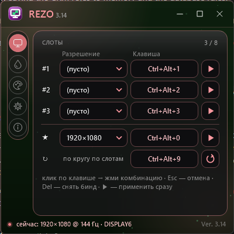
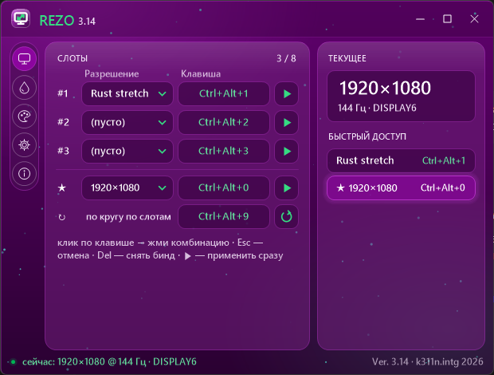
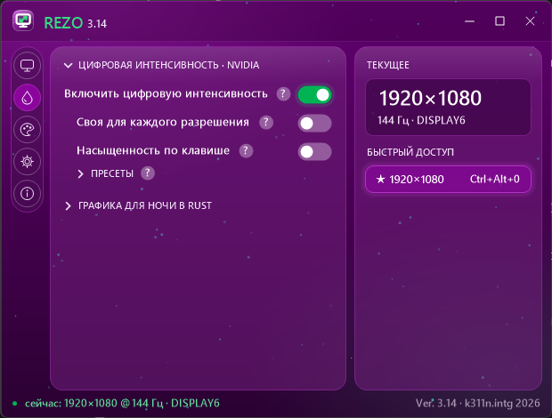
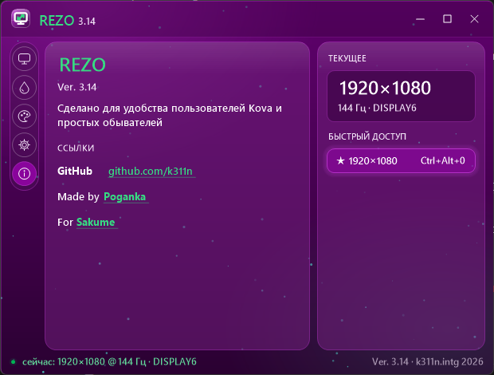
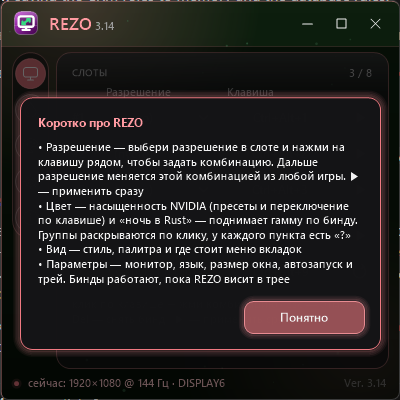
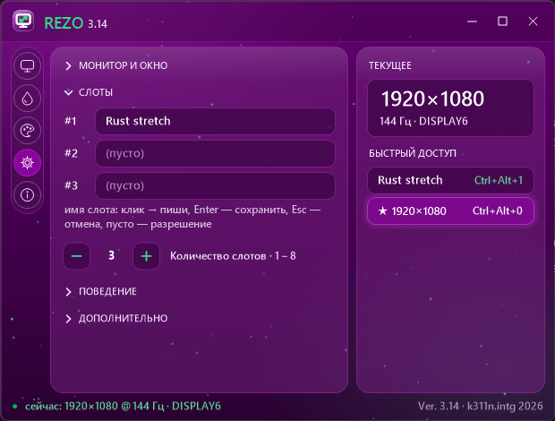
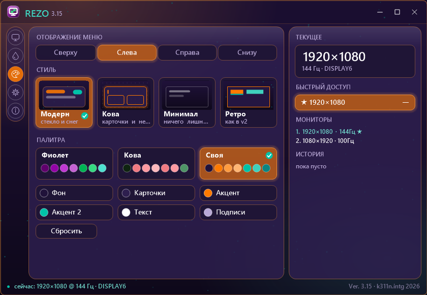
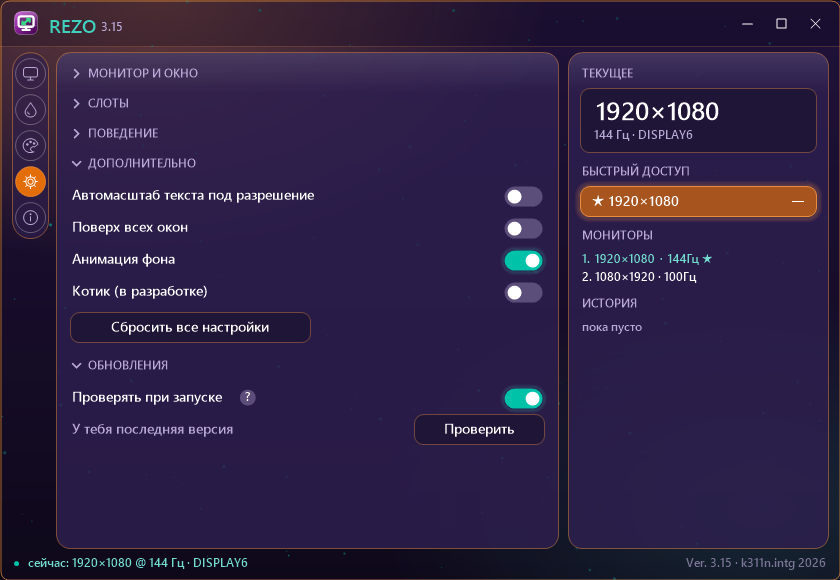

# REZO

Change your screen resolution with global hotkeys — straight from a game, without alt-tabbing. Plus NVIDIA digital vibrance and a "night in Rust" gamma toggle.

Windows 10/11 · .NET Framework 4.x (already in Windows) · v3.15

## Features
- **Resolution slots** — up to 8 slots plus a default, each with its own hotkey. A cycle hotkey loops through them. ▶ applies right away. Slots can be renamed (Settings → Slots), the name shows in the list, the tray menu and quick access
- **Color** (NVIDIA): digital vibrance on/off, 4 presets + normal (50%), saturation per resolution slot, and a hotkey that flips between two values X ↔ Y
- **Night graphics for Rust** — a hotkey raises Windows gamma from the middle of the scale to the top, press again to restore (one-time unlock button for `GdiIcmGammaRange`)
- **Tray** — hotkeys keep working in the tray. Optional "minimize to tray on close", autostart, start minimized
- **Look** — 4 styles (Modern, Kova, Minimal, Retro), 3 palettes (Violet, Kova, Custom: pick 6 colors yourself), tab menu on top/left/right/bottom
- **Window** — resizes like a normal window, S/M/L presets, native maximize, Aero Snap and Win11 Snap Layouts, text scales with the window
- **Updates** — Settings → Updates → «Check»: asks GitHub Releases for a newer version and updates in one click (installed copy runs the silent installer, portable copy swaps its exe and restarts). The download must be signed by k311n.intg. "Check on startup" is off by default, REZO makes no other network requests
- **Reset** — Settings → Extra → «Reset all settings»
- Every option has a «?» with a short explanation. RU / ENG
- Installer with uninstaller, shortcuts, an Apps entry and a signed build (CN=k311n.intg)

## Install
Download `REZO_Setup_3.15.exe` from [Releases](../../releases) and run it. The installer can also add autostart, unlock gamma and trust the k311n.intg certificate.
Portable: download `REZO.exe` and run it from any folder (settings are saved next to the exe).

## Default hotkeys
| Action | Hotkey |
|---|---|
| Slot 1 / 2 / 3 | Ctrl+Alt+1 / 2 / 3 |
| Default resolution | Ctrl+Alt+0 |
| Cycle | Ctrl+Alt+9 |
| Saturation presets 1 / 2 | Ctrl+Alt+Shift+1 / 2 |
| Normal saturation (50%) | Ctrl+Alt+Shift+5 |
| Night in Rust (enable it in Color first) | Ctrl+Alt+N |

Click a hotkey field → press a combo. Esc cancels, Del clears. One combo = one action.

## Screenshots
| | |
|---|---|
|  |  |
|  |  |
|  |  |
|  | |

## Credits
Made by [Poganka](https://kova.page/k311n) · For [Sakume](https://kova.page/sakume)
GitHub: [k311n](https://github.com/k311n)

© 2026 k311n.intg — all rights reserved, see [LICENSE](LICENSE)

---

# REZO (ru)

меняет разрешение экрана по хоткеям прям из игры без всяких альттабов, плюс насыщенность nvidia и ночная гамма для раста

винда 10/11 · нужен .net framework 4 (он и так в винде есть) · версия 3.15

## че умеет
- **слоты разрешений** — до 8 штук плюс дефолт, на каждый свой бинд, есть бинд по кругу, ▶ применяет сразу, слотам можно дать свое имя (параметры → слоты), оно видно в списке, в трее и в быстром доступе
- **цвет** (nvidia) — цифровая интенсивность вкл/выкл, 4 пресета и норма 50%, своя насыщенность на каждый слот и бинд который кидает между X и Y
- **ночь в расте** — по бинду задирает гамму винды с середины шкалы до верха, жмешь еще раз и все как было (гамму надо один раз разблочить кнопкой)
- **трей** — бинды работают из трея, можно чтоб крестик сворачивал в трей, автозапуск, старт свернутым
- **вид** — 4 стиля (модерн, кова, минимал, ретро), 3 палитры (фиолет, кова и своя, где сам тыкаешь 6 цветов), меню вкладок сверху слева справа или снизу
- **окно** — тянется за края как обычное, пресеты S M L, разворачивается на весь экран, snap работает, текст подстраивается под размер
- **обновы** — параметры → обновления → «проверить»: смотрит релизы на гитхабе и обновляет в один клик (установленная ставит себя тихо, портативная меняет свой exe и перезапускается), файл обязан быть подписан k311n.intg. проверка при запуске по дефолту выключена, больше прога в сеть не лезет
- **сброс** — параметры → дополнительно → «сбросить все настройки»
- у каждой настройки есть «?» где по-человечески написано че она делает, есть ru и eng
- установщик с удалялкой, ярлыками и подписью

## как поставить
качаешь `REZO_Setup_3.15.exe` в релизах и запускаешь, там же галочки на автозапуск, разблок гаммы и сертификат
или портативно — просто `REZO.exe` в любую папку, настройки лягут рядом

## бинды по дефолту
- слоты 1 2 3 — ctrl+alt+1 2 3
- дефолтное разрешение — ctrl+alt+0
- по кругу — ctrl+alt+9
- пресеты насыщенности 1 2 — ctrl+alt+shift+1 2
- норма насыщенности — ctrl+alt+shift+5
- ночь в расте — ctrl+alt+n (сначала включи во вкладке цвет)

тыкаешь в поле бинда и жмешь комбу, esc отмена, del снять, одна комба одно действие

## кто
сделано [poganka](https://kova.page/k311n) для [sakume](https://kova.page/sakume)
гитхаб [k311n](https://github.com/k311n)

© 2026 k311n.intg все права защищены
