# REZO 5.0 — stretched res on a hotkey, game profiles that switch by themselves

Download → pick a ready set (Stretched / Native) → press the key in the game. Change your screen resolution with global hotkeys straight from a game, no alt-tab. Wrong mode and a black screen? REZO puts the old one back after 10 seconds.

Windows 10/11 · .NET Framework 4.x (already in Windows) · v5.0 · NVIDIA saturation works on NVIDIA cards only

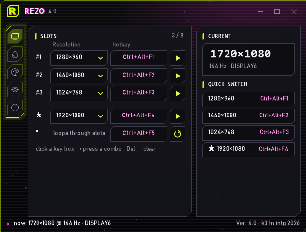

## Features
- **Resolution slots** — up to 8 slots plus a default, each with its own hotkey. A cycle hotkey loops through them. ▶ applies right away. Slots can be renamed (Settings → Slots), the name shows in the list, the tray menu and quick access
- **Color** (NVIDIA): digital vibrance on/off, 4 presets + normal (50%), saturation per resolution slot, and a hotkey that flips between two values X ↔ Y
- **Night graphics for Rust** — a hotkey raises Windows gamma from the middle of the scale to the top, press again to restore (one-time unlock button for `GdiIcmGammaRange`)
- **Tray** — hotkeys keep working in the tray. Optional "minimize to tray on close", autostart, start minimized
- **Look** — 5 styles (Acid Chapel by default, Modern, Kova, Minimal, Retro), 4 palettes (Acid Chapel, Violet, Kova, Custom: pick 6 colors yourself), tab menu on top/left/right/bottom
- **Window** — resizes like a normal window, S/M/L presets, native maximize, Aero Snap and Win11 Snap Layouts, text scales with the window
- **Game profiles** (new in 5.0) — per game: resolution slot, NVIDIA saturation, night gamma. Four trigger modes in Settings → Game profiles: Launch via REZO (▶ or a desktop shortcut, recommended), Process list, Focused window, WMI (instant, admin). Everything is put back when the game closes, on exit and even after a crash
- **First start** — a 3-step guide and ready sets: Stretched (1280×960, 1440×1080, 1024×768) or Native + 1080p, only modes your monitor supports, keys Ctrl+Alt+F1…F3
- **Safe switch** — a new resolution asks «Keep?» for 10 s; no answer or Esc puts the old one back (Settings → Behavior)
- **Feedback** — About → «Idea» / «Thanks» open a GitHub issue with a template (REZO and Windows version only); «Write feedback» sends a short message to a Google Form right from the app (type, text, optional contact; no other data)
- **Updates** — Settings → Updates → «Check»: asks GitHub Releases for a newer version and updates in one click (installed copy runs the silent installer, portable copy swaps its exe and restarts). The download must be signed by k311n.intg. "Check on startup" is off by default, REZO makes no other network requests
- **Reset** — Settings → Extra → «Reset all settings»
- Every option has a «?» with a short explanation. RU / ENG
- Installer with uninstaller, shortcuts, an Apps entry and a signed build (CN=k311n.intg)

## Install
Download `REZO_Setup_5.0.exe` from [Releases](../../releases) and run it. The installer can also add autostart, unlock gamma and trust the k311n.intg certificate.
Portable: download `REZO.exe` and run it from any folder (settings are saved next to the exe).

## Default hotkeys
| Action | Hotkey |
|---|---|
| Slot 1 / 2 / 3 | Ctrl+Alt+1 / 2 / 3 |
| Default resolution | Ctrl+Alt+0 |
| Cycle | Ctrl+Alt+9 |
| Saturation presets 1 / 2 | Ctrl+Alt+Shift+1 / 2 |
| Normal saturation (50%) | Ctrl+Alt+Shift+5 |
| Night in Rust (enable it in Color first) | Ctrl+Alt+N |

Click a hotkey field → press a combo. Esc cancels, Del clears. One combo = one action.

## Screenshots
**Styles** (left RU, right EN)
| RU | EN |
|---|---|
| 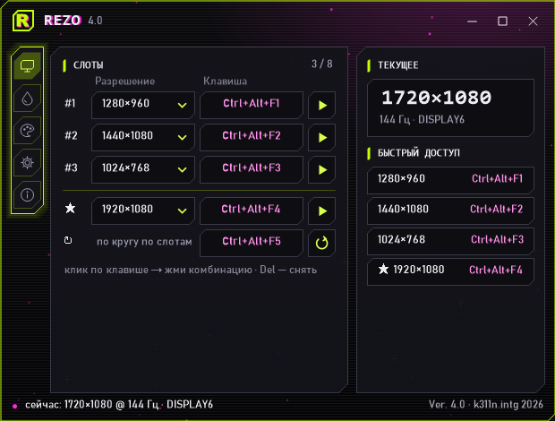 |  |
| 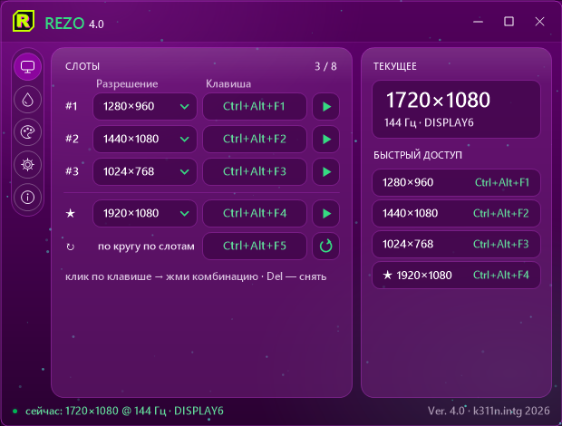 | 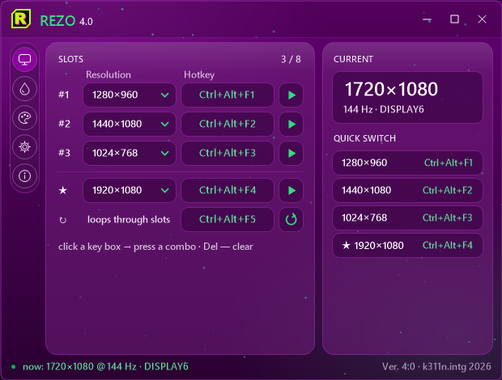 |
| 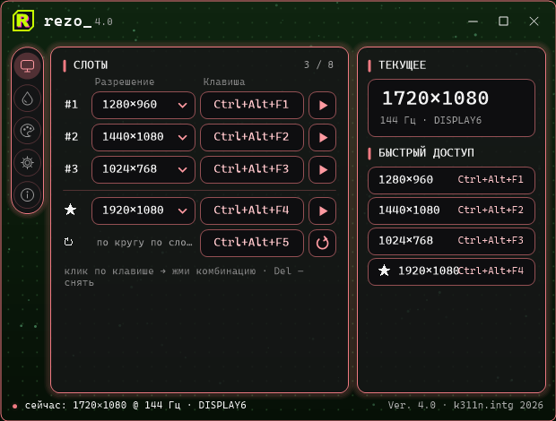 | 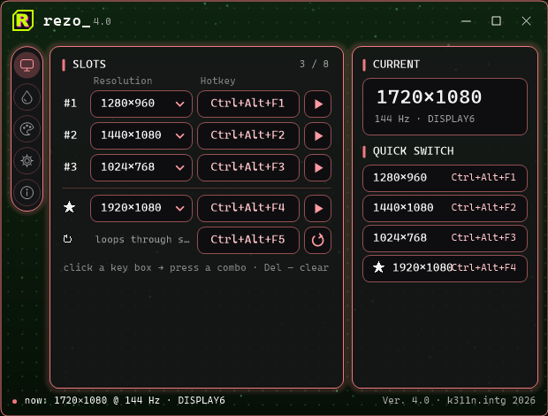 |
| 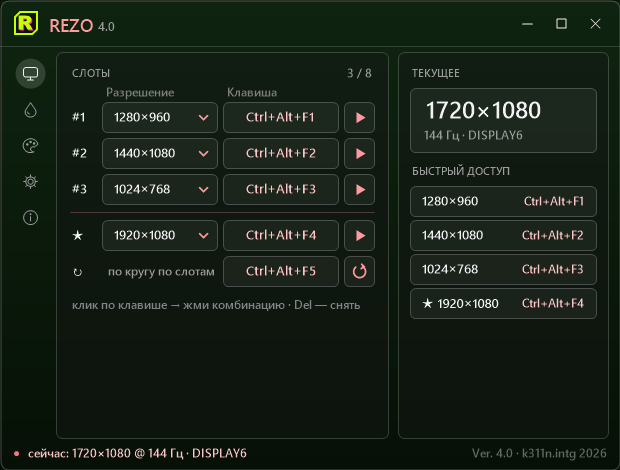 | 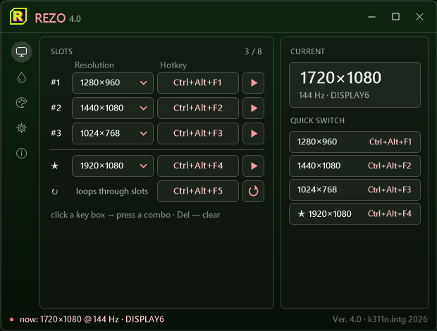 |
| 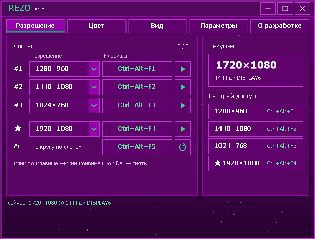 | 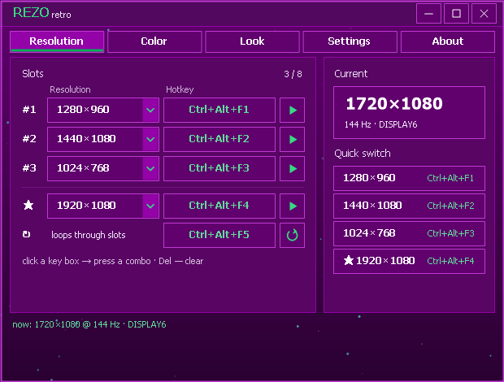 |

**First start and safe switch**
| | |
|---|---|
| 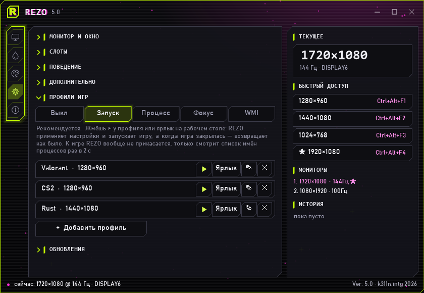 | 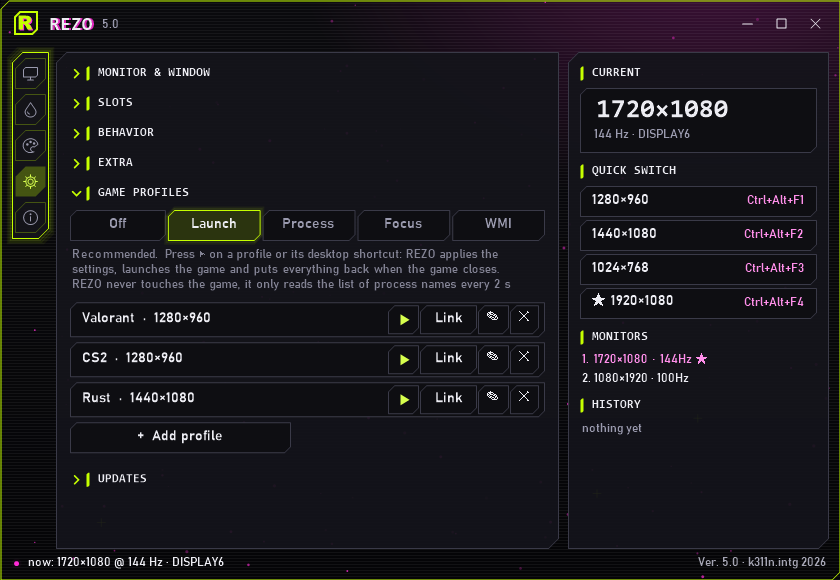 |
| 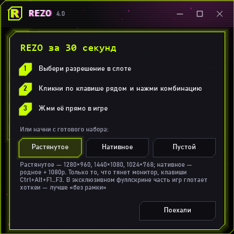 | 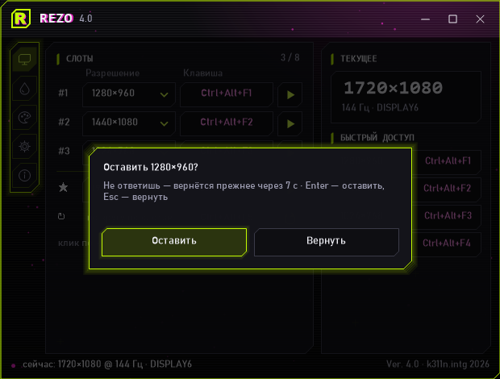 |
| 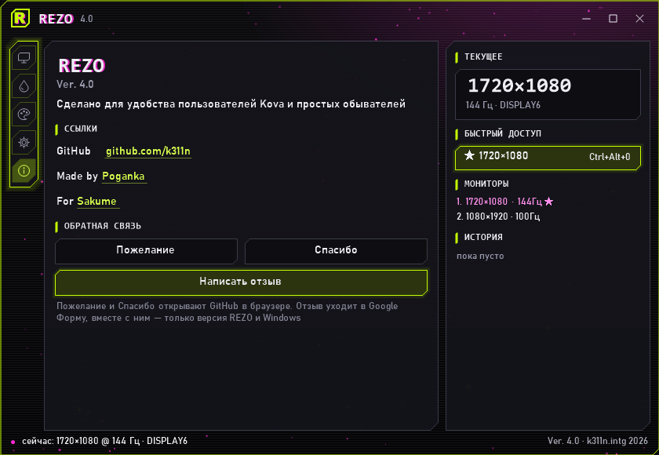 | |

## Anti-cheat
REZO is built to stay away from games. What it does and doesn't do:
- **Does:** change the resolution (ChangeDisplaySettingsEx), NVIDIA digital vibrance (NVAPI) and gamma (SetDeviceGammaRamp) — system settings, the same things the Windows and NVIDIA control panels change.
- **Reads only process names** from a system snapshot (like Task Manager), at most once every 2 s. «Focus» mode also reads which process owns the focused window.
- **Never:** opens the game process, reads or writes its memory, injects DLLs, installs hooks, draws overlays, sends input or messages to game windows, or uses drivers. Games are launched via the shell without taking a handle to them.
- No anti-cheat vendor certifies REZO, so there is no «100% safe» promise. «Launch via REZO» and «Process» are the calmest modes; «Focus» changes resolution on every alt-tab and is the riskiest. If unsure, change resolution before starting the game.

# REZO (ru)

ставишь и кайфуешь: скачал, выбрал набор (растянутое или нативное), жмешь клавишу в игре. если монитор не потянул и экран черный — через 10 сек само вернется как было. плюс насыщенность nvidia (только на картах nvidia) и ночная гамма для раста

винда 10/11 · нужен .net framework 4 (он и так в винде есть) · версия 5.0

## че умеет
- **слоты разрешений** — до 8 штук плюс дефолт, на каждый свой бинд, есть бинд по кругу, ▶ применяет сразу, слотам можно дать свое имя (параметры → слоты), оно видно в списке, в трее и в быстром доступе
- **цвет** (nvidia) — цифровая интенсивность вкл/выкл, 4 пресета и норма 50%, своя насыщенность на каждый слот и бинд который кидает между X и Y
- **ночь в расте** — по бинду задирает гамму винды с середины шкалы до верха, жмешь еще раз и все как было (гамму надо один раз разблочить кнопкой)
- **трей** — бинды работают из трея, можно чтоб крестик сворачивал в трей, автозапуск, старт свернутым
- **вид** — 5 стилей (по дефолту acid chapel, еще модерн, кова, минимал, ретро), 4 палитры (acid chapel, фиолет, кова и своя, где сам тыкаешь 6 цветов), меню вкладок сверху слева справа или снизу
- **окно** — тянется за края как обычное, пресеты S M L, разворачивается на весь экран, snap работает, текст подстраивается под размер
- **профили игр** (новое в 5.0) — на каждую игру свой слот разрешения, насыщенность nvidia и ночная гамма. 4 режима в параметрах → профили игр: запуск через rezo (▶ или ярлык на рабочем столе, рекомендую), по списку процессов, по окну в фокусе, wmi (мгновенно, нужен админ). когда игра закрылась — все возвращается как было, даже если rezo упал
- **первый запуск** — гайд в 3 шага и готовые наборы: растянутое (1280×960, 1440×1080, 1024×768) или нативное + 1080p, только то что тянет монитор, клавиши ctrl+alt+f1…f3
- **страховка** — новое разрешение спрашивает «оставить?» 10 сек, не ответил или esc — вернется прежнее (параметры → поведение)
- **обратная связь** — о разработке → «пожелание» и «спасибо» открывают issue на гитхабе с шаблоном (только версия rezo и винды), «написать отзыв» шлет короткое сообщение в гугл форму прям из проги (тип, текст, контакт по желанию, больше ничего)
- **обновы** — параметры → обновления → «проверить»: смотрит релизы на гитхабе и обновляет в один клик (установленная ставит себя тихо, портативная меняет свой exe и перезапускается), файл обязан быть подписан k311n.intg. проверка при запуске по дефолту выключена, больше прога в сеть не лезет
- **сброс** — параметры → дополнительно → «сбросить все настройки»
- у каждой настройки есть «?» где по-человечески написано че она делает, есть ru и eng
- установщик с удалялкой, ярлыками и подписью

## как поставить
качаешь `REZO_Setup_5.0.exe` в релизах и запускаешь, там же галочки на автозапуск, разблок гаммы и сертификат
или портативно — просто `REZO.exe` в любую папку, настройки лягут рядом

## бинды по дефолту
- слоты 1 2 3 — ctrl+alt+1 2 3
- дефолтное разрешение — ctrl+alt+0
- по кругу — ctrl+alt+9
- пресеты насыщенности 1 2 — ctrl+alt+shift+1 2
- норма насыщенности — ctrl+alt+shift+5
- ночь в расте — ctrl+alt+n (сначала включи во вкладке цвет)

тыкаешь в поле бинда и жмешь комбу, esc отмена, del снять, одна комба одно действие

## кто
сделано [poganka](https://kova.page/k311n) для [sakume](https://kova.page/sakume)
гитхаб [k311n](https://github.com/k311n)

© 2026 k311n.intg все права защищены

## античиты не ругаются
rezo специально держится подальше от игр. что делает и чего нет:
- **делает:** меняет разрешение (ChangeDisplaySettingsEx), цифровую интенсивность nvidia (NVAPI) и гамму (SetDeviceGammaRamp) — это системные настройки, то же самое крутят панель винды и nvidia
- **читает только имена процессов** из системного снимка (как диспетчер задач), не чаще раза в 2 сек. режим «фокус» еще смотрит, чей процесс у окна в фокусе
- **никогда:** не открывает процесс игры, не читает и не пишет ее память, не внедряет dll, без хуков, оверлеев, эмуляции ввода и сообщений в окна игры, без драйверов. игра запускается через оболочку винды без хэндла на процесс
- ни один античит rezo не сертифицировал, так что «100% безопасно» никто не обещает. «запуск через rezo» и «процесс» самые спокойные режимы, «фокус» меняет разрешение на каждый альт-таб и самый рискованный. сомневаешься — меняй разрешение до запуска игры
